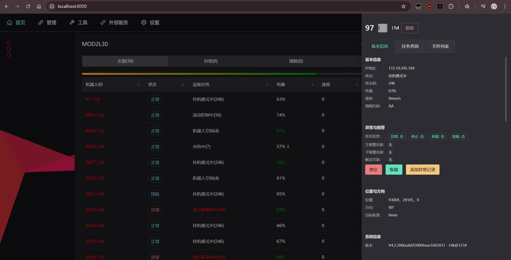

# AGVMON - AGV 机器人监控管理

AGV 实时监控与运维管理平台，提供机器人状态监控、任务调度、地图可视化、远程 SSH 诊断、DataMatrix 编解码及日志分析等功能。

## 技术栈

| 组件 | 技术 |
|------|------|
| 后端框架 | Python 3.12+ / FastAPI |
| ASGI 服务器 | uvicorn |
| 前端 | Vue 3 + Vite 8 + Naive UI |
| 代码编辑器 | Monaco Editor（VS Code 内核，用户脚本页按需加载） |
| 消息队列 | ZeroMQ（实时状态）、RabbitMQ（任务队列） |
| 缓存/存储 | Redis / SQLite |
| 数据解析 | lxml (XML)、orjson (JSON) |
| 用户脚本沙箱 | lupa（Lua 5.5）+ 独立 worker 子进程 + 宿主代理外部 HTTP |
| SSH | asyncssh |
| 图像处理 | Pillow、pylibdmtx |

## 项目结构

```
├── backend/                # FastAPI 后端
│   ├── app.py              # 应用入口，路由注册，中间件
│   └── api/                # API 模块
│       ├── rcmsapi.py      # RCMS REST API 代理
│       ├── rcswebapi.py    # RCS2000 Web 接口
│       ├── wcsapi.py       # WCS 设备状态接口
│       ├── agvssh.py       # AGV SSH 远程连接
│       ├── tcp_client.py   # TCP 调试客户端接口（REST + WebSocket）
│       ├── user_script.py  # 用户自定义 Lua 脚本（沙箱执行 + 访问闸门）
│       ├── log_parser.py   # 日志分析 API（AGV/WCS/Clean）
│       ├── websocket.py    # WebSocket 实时推送
│       ├── startup.py      # 启动事件
│       └── ...
├── util/                   # 核心工具库（按职责域分子包）
│   ├── config.toml         # 配置文件
│   ├── core/               # 基础设施
│   │   ├── config.py       # 配置管理器（TOML）
│   │   ├── logger.py       # loguru 封装
│   │   ├── paths.py        # 资源路径常量（DATA_DIR / TOOL_DIR / PROJECT_ROOT）
│   │   ├── helper.py       # 通用辅助
│   │   ├── updater.py      # 自更新
│   │   └── __version__.py  # 版本号（打包时由 build_nuitka.py 改写）
│   ├── net/                # 外部通信
│   │   ├── ssh.py          # SSH 连接管理
│   │   ├── rcms_api.py     # RCMS REST API
│   │   ├── rcs_web_api.py  # RCS2000 Web API
│   │   ├── wcs.py          # WCS 接口
│   │   ├── rabbitmq.py     # RabbitMQ 客户端
│   │   ├── zeromq.py       # ZeroMQ 订阅
│   │   ├── tcp_client.py   # TCP 调试客户端（连接管理 / 收发记录）
│   │   ├── gossip.py       # 设备发现
│   │   └── showrobot.py    # 机器人状态展示
│   ├── logs/               # 日志解析
│   │   ├── agvlog.py       # AGV 日志下载 / 解压 / PIO 分析（主入口）
│   │   ├── parse_agvlog.py # 纯 Python zlib 解压（parsezlib exe 的等价重写）
│   │   ├── parse_wcs_log.py# WCS 日志下载与解析
│   │   └── clean.py        # 磁盘清理
│   ├── codec/              # 协议与编解码
│   │   ├── agv_protocol_parser.py # AGV 二进制协议解析
│   │   ├── dataparse.py    # 地图 / 告警 / 状态数据解析
│   │   ├── dmdecoder.py    # DMDTX 编解码
│   │   ├── xml2json.py     # XML → JSON
│   │   └── yuv2png.py      # YUV 图像转换
│   ├── lua/                # 用户 Lua 脚本
│   │   ├── lua_sandbox.py  # 沙箱环境（白名单 + 纯 Lua JSON，仅 worker 导入）
│   │   ├── lua_worker.py   # 脚本执行子进程入口（stdin/stdout JSON 协议）
│   │   ├── lua_runtime.py  # 执行宿主（起进程、超时强杀、并发闸门）
│   │   ├── lua_http.py     # 外部 HTTP 桥接
│   │   └── user_script_store.py # 脚本库与执行流水（lua_script/：.lua 文件 + SQLite 索引）
│   ├── tool/               # 随包二进制（parsezlib_2_7_8.exe）
│   └── data/               # 缓存/模拟数据/图像资源
├── lua_script/             # 用户自定义 Lua 脚本（运行期数据，不进仓库）
│   ├── <script_id>.lua     # 脚本正文（真身，可直接用编辑器改）
│   ├── user_scripts.db     # 元信息 + 执行流水（SQLite 索引/缓存）
│   └── .backup/            # 覆盖或删除前的历史正文（每脚本保留 5 份）
├── web/                    # Vue 3 前端
│   ├── src/
│   │   ├── views/          # 页面视图
│   │   ├── components/     # 通用组件
│   │   └── router/         # 路由配置
│   └── dist/               # 编译产物
├── static/                 # 自托管 API 文档静态文件
├── main.py                 # CLI 入口
├── build_nuitka.py         # Nuitka 打包脚本
└── pyproject.toml
```

## 快速开始

### 环境要求

- Python >= 3.12
- Node.js >= 20.19（前端开发）
- Redis 服务
- 可选：uv（Python 包管理器）

### 安装

```bash
# 安装 Python 依赖
pip install -e .
# 或使用 uv
uv sync

# 安装前端依赖并构建
cd web
npm install
npm run build
cd ..
```

### 配置

编辑 `util/config.toml` 配置 RCMS 服务器地址、Redis 连接、AGV SSH 凭据等：

```toml
[rcms]
host = "192.168.1.100"
rcms_url = "http://192.168.1.100:8080"
mapcode = "your_map_code"

[redis]
host = "127.0.0.1"
port = 6379
db = 0

[web]
host = "0.0.0.0"
port = 8000

# 用户 Lua 脚本：外部 HTTP 权限（脚本里 http.* 的能力边界）
[user_script.http]
enabled = true                 # 关掉后所有请求返回 error_type = http_disabled
allowed_hosts = []             # 白名单，空 = 任意主机；支持 "*.example.com"
blocked_hosts = []             # 黑名单，优先级高于白名单
allow_private_hosts = false    # 是否允许内网/回环地址（默认禁止，防 SSRF）
timeout_ms = 2500              # 单次请求超时
max_requests_per_run = 6       # 单次执行最多发几次请求
max_response_kb = 512          # 响应体上限（超出截断，truncated = true）
```

要调外部接口的脚本记得把 `[user_script] timeout_ms` 留够（默认 8000ms，一次外网调用约 1-3s）。

### 运行

```bash
# 启动 Web 服务
agvmon run web

# 或直接使用
python main.py run web

# 启动实时地图更新（ZeroMQ）
agvmon run zeromq

# 构建地图缓存
agvmon build raw
agvmon build genmap

# 查看所有命令
agvmon --help
```

启动后访问 `http://localhost:8000` 查看监控面板。

## 功能模块

### 实时监控
- 机器人状态仪表盘（位置、电量、速度、载货状态、告警）
- 机器人路径实时可视化
- WebSocket 自动推送更新

### 地图系统
- 从 RCMS 共享地图数据生成 PNG/SVG 地图
- 实时机器人位置叠加
- 区域标签和设备标记

### 任务管理
- 任务查询与详情查看（含子任务）
- 任务控制：暂停/恢复、取消、强制取消、释放
- 滚动状态实时检测

### SSH 远程诊断
- 异步 SSH 连接单个 AGV
- 远程文件浏览、上传、下载、预览
- YUV 摄像头图像转 PNG
- 命令注入防护

### DataMatrix 编解码
- DataMatrix 条码编码（SVG 输出）
- 解码识别
- 适用于 AGV 路径物理标记识别

### TCP 调试客户端（管理 → TCP 客户端）
- 连接任意 `host:port`，文本 / HEX 双向收发
- 收发记录由后端保留（每会话默认 500 条），WebSocket 实时推送（`/ws/tcp-client/{id}`）
- 断线自动重连、定时发送、编码可选（utf-8 / gbk / ascii …）、收发方向过滤与自动滚动
- 接口：`/api/tcp/sessions*`（REST），配置见 `[tcp_client]`（白名单、上限、超时等）
- 冒烟测试：`python test_tcp_client.py`（本地回环，无需 Redis / RCMS）

### 用户自定义脚本（Lua 沙箱）（管理 → 用户脚本）
用户上传 Lua 脚本，由平台在沙箱中用它处理请求数据，定位与 Cloudflare Workers / OpenResty 类似。

- **进程级隔离**：每次执行拉起独立 worker 子进程（`agvmon run lua-worker`），
  超时直接 `TerminateProcess` 强杀，脚本死循环 / 崩溃 / 内存爆炸都拖不垮主服务
- **环境白名单**：全局表在 prelude 里重建，脚本只能看到纯 Lua 与安全子集
  （`string`/`table`/`math`/`utf8`/`coroutine` 及 `os.date|time|clock|difftime`）；
  `os.execute`、`io`、`package`、`require`、`load`、`dofile`、`debug`、`collectgarbage`、
  lupa 注入的 `python` 全局**一律不存在**
- **只传字符串**：宿主与 Lua 之间只交换 JSON 文本，不注入任何 Python 对象，
  从根本上堵掉 `f.__globals__["__builtins__"]["__import__"]("os")` 这类属性链逃逸。
  唯一的例外是外部 HTTP 桥（一个 Python 可调用对象），它只作为 **Lua 闭包的 upvalue**
  存在，既不在 `_G` 里也不在任何脚本能索引到的表里（`test_user_script.py` 有对应回归用例）
- **能调外部接口**：脚本里的 `http.get/post/put/patch/delete/request` 由宿主代发，
  受 `[user_script.http]` 的主机白名单、内网开关、次数/超时/体积上限约束，
  重定向每一跳都要重新过策略（防跳板）；
  "拿上游数据 → 处理 → POST 中转给下游" 的完整例子见「插入示例」
- **内存硬限**：由 lupa 的 `max_memory` 在 C 层限制 Lua 分配器，超限抛 `LuaMemoryError`
- 默认**仅本机可调用**；远程需同时开启 `allow_remote` 并配置 `api_key`
- 接口：`/api/user-script*`，配置见 `[user_script]` / `[user_script.http]`
- 冒烟测试：`python test_user_script.py`（189 项检查，公网端到端那条连不上时会标 `[SKIP]`、
  总数少 1；含逃逸回归 / 超时 / 内存 / 接口 / 鉴权 / 脚本目录 / 外部 HTTP 与 mock 上游端到端 /
  脚本即 API 端点 / 前端模板绑定与 monaco 接线与 worker-CSP 一致性 / Lua 文法真词法器自检 /
  `LUA_SCRIPT_GUIDE.md` 里每段 Lua 的真编译自检）

**脚本存哪**：`<根目录>/lua_script/`，一个脚本一个 `.lua` 文件，**正文以文件为准**。

> 📘 **写脚本之前先看 [`LUA_SCRIPT_GUIDE.md`](./LUA_SCRIPT_GUIDE.md)** —— 面向 AI（人同样适用）的完整
> 编写指南：运行模型、`ctx` 全字段、入参三种调用姿势、JSON 语义与坑、`http.*` 与错误码表、
> 当 API 端点的 `__status`/`__headers`、白名单、资源预算、可复制的 5 套脚本模式、反模式清单与
> 交付前自检清单。文档里的每段 Lua 都会被冒烟测试用真 Lua 编译器验一遍语法。

```
lua_script/
├── <script_id>.lua     # 脚本正文（真身），可以直接用 VSCode 改，甚至纳入 git 管理
├── user_scripts.db     # 元信息（名称/启用/版本/统计）+ 执行流水的 SQLite 索引
└── .backup/            # 覆盖或删除前的历史正文，每个脚本最多留 5 份
```

- 页面保存时会写文件 + 更新索引；**外部直接改文件也生效**：下次读取/执行时发现内容与索引
  不一致就以文件为准并递增版本（日志里有 `用户脚本 xxx` 的版本变化），无需重启服务
- 文件被误删会用索引里的副本自动重建；删除脚本时正文先进 `.backup/` 再删
- 目录放在 exe 同级（打包后即程序运行目录，由运行期自动创建）：更新流程是
  robocopy 覆盖 + 不清理，包内也不含该目录，所以版本更新不会冲掉用户脚本
- 仓库里**不带**任何示例脚本（这是运行期数据，不入库也不该被版本更新覆盖）：
  示例都在代码里（`web/src/composables/luaExamples.js`），打开页面点「插入示例」即可灌进编辑器

**网页管理页**：`管理 → 用户脚本`（路由 `/user-script`）。编辑器是 **Monaco**（VS Code
同款内核），带 Lua 语法高亮、**输入即提示**（关键字/片段/沙箱 API/`ctx.`/`json.`/`http.` 成员）、
鼠标悬停看 API 文档，另有查找替换、括号配色、折叠、多光标、注释切换（Ctrl+/）、
粘性滚动；快捷键 Ctrl+Enter 运行、Ctrl+S 保存。页面还提供脚本列表与搜索、语法检查、
JSON 请求体试运行、返回值与 `print`/`log` 日志展示、执行流水、「插入示例」下拉（4 个可跑示例：
基础回显、脚本即 API 端点、调外部 API 后中转、数据校验与字段映射），以及脚本约定文档 ——
文档里连"其他服务怎么调这个脚本、跨机要开什么"都写清楚了。

Monaco 走动态 import（独立 chunk，约 3.7MB，只有打开这个页面才下载）；万一 chunk 加载失败，
组件会自动退回内置的轻量编辑器而不是白屏。

> ⚠️ **monaco 的 worker 必须内联**：后端 CSP 是 `worker-src blob:`（`backend/app.py` 的
> `add_security_headers`），而 vite 默认的 `?worker` 会产出同源文件
> `assets/editor.worker-*.js`，浏览器会以 `… violates … worker-src blob:` 拦掉，monaco 只能退回
> 主线程（控制台还会跟一条 uncaught Event）。所以 `luaMonaco.js` 里写的是
> `editor.worker.js?worker&inline`：vite 把 worker 打成 base64、运行时 `createObjectURL` 出 `blob:`。
> 改这一行请同步跑冒烟测试（`lua_worker_csp_problems()` 会校验"源码里的 worker 导入 ↔ 后端 CSP"，
> 并检查 dist 里没有残留的独立 worker 文件）。

脚本写法（两种风格任选其一）::

```lua
-- 风格一：定义 handle(ctx)，返回值即结果
function handle(ctx)
  local car = ctx.input.car                 -- 请求体已经是 Lua 表
  if car == nil then
    return { ok = false, msg = "缺少 car 字段" }
  end
  ctx.log("处理 " .. car)                    -- print/console 会被收集进响应
  return { ok = true, car = car, ts = os.time() }
end

-- 风格二：顶层直接 return，或往全局 output 里塞
output.count = #json.decode(ctx_input_raw)
```

`ctx` 字段：`input`（请求体）、`output`（结果表）、`script_id`、`now`、`json`、`log`、`limits`；
全局另有 `input` / `output` / `print` / `console` / `json` / `http` / `os` / `string` / `table` / `math` / `utf8`。

调外部 API 并中转（完整可跑的例子在页面「插入示例」里）::

```lua
function handle(ctx)
  local r = http.get("http://10.0.0.5:8080/api/task/1001")
  if not r.ok then
    return { ok = false, stage = "upstream", error = r.error }   -- 传输层失败不抛错
  end

  local task = r.json or {}                                      -- Content-Type 是 JSON 时会自动解码
  local out = { id = task.id, car = ctx.input.car, ts = os.time() }

  local sent = http.post("http://10.0.0.9:9000/hook", out)       -- 中转给下游（table 自动 JSON 序列化）
  return { ok = true, upstream = r.status, relayed = sent.ok, data = out }
end
```

`http.*` 的返回值固定是 table：`ok`（传输是否成功）、`status`、`headers`、`body`、
`json`（响应是 JSON 时自动解码）、`bytes`、`truncated`、`url`、`error`、`error_type`。
注意 **DNS 失败 / 超时 / 被策略拦下** 都是 `ok = false`，而 **HTTP 4xx/5xx 是 `ok = true`**
（传输成功），要不要算失败由脚本自己看 `status` 决定。错误类型：
`http_disabled` / `http_blocked` / `http_dns` / `http_timeout` / `http_network` /
`http_method` / `http_url` / `http_badarg` / `http_size` / `http_busy`。

**脚本即 API 端点**：脚本保存后本身就是一个 HTTP 接口，其他服务可以直接调它
（示例见页面的「插入示例 → 脚本即 API 端点」，本地脚本 `demo.api.lua`）：

```bash
# 只带 query 最省事（脚本里读 ctx.input / ctx.query，query 值都是字符串）
curl "http://127.0.0.1:8000/api/user-script/demo.api/run?car=AGV-07&step=12"

# 直接 POST 业务 JSON（整个 body 就是入参）
curl -X POST http://127.0.0.1:8000/api/user-script/demo.api/run \
  -H 'Content-Type: application/json' -d '{"car":"AGV-07","step":12}'

# POST /api/user-script/<id> 是等价别名；老式 {"payload":{...}} 包装体也仍然兼容
```

脚本侧能拿到的东西：`ctx.input`（query 与 body 已合并，同名字段以 body 为准）、
`ctx.query`、`ctx.body`（原始请求体）、`ctx.request`（`method` / `path` / `ip` / `headers`）。
返回值就是响应体；脚本还可以用保留键 **`__status`** 指定 HTTP 状态码、**`__headers`**
追加响应头（这两个键不会出现在响应体里，响应体里会多一个 `http_status` 便于排查）。
例如参数不对就 `return { ok = false, error = "缺少 car 参数", __status = 400 }`，
上游挂了就 `__status = 502`。

响应是统一的执行信封：`{"success":true,"ok":true,"duration_ms":123,"script_id":"...",
"result":<脚本返回值>,"logs":[...],"version":3,"http_status":400}` —— 调用方读 `result`
即可；脚本自身报错仍在信封里用 `ok=false` + `error_type` 表达（HTTP 仍是 200，
只有脚本显式给了 `__status` 才会改状态码）。

要让**其他机器 / 其他服务**调用，需要在 `config.toml` 里放开闸门，然后带上 API Key：

```toml
[user_script]
allow_remote = true
api_key = "换成一串足够长的随机串"     # 调用方请求头带 X-API-Key: <这串>
```

未放开时非本机请求会收到 403，响应里直接写明怎么开。脚本看不到 `X-API-Key`
（传给脚本的请求头是白名单：content-type / user-agent / accept / x-request-id /
x-forwarded-for / x-real-ip / referer / origin / host）。

几个容易踩的点：

- **JSON null 映射为 `json.null` 哨兵**（参考 lua-cjson 的 `cjson.null`），
  判断请用 `v == json.null`；只有"字段缺失"才是 `nil`。这样数组里的 null 不会丢位置
- Lua 5.5 起字符串字面量里的 `\uXXXX` 是语法错误，要写 `\u{4e2d}`；
  嵌 JSON 建议用长括号 `[==[ ... ]==]`（注意 JSON 里可能出现 `]]`，所以别用 `[[ ]]`）
- 结果必须是 JSON 可编码类型（字符串/数字/布尔/表/null），返回函数或循环引用会明确报错
- 单次执行约 55-90ms，其中脚本本身通常只占 2-5ms，其余是 worker 进程冷启动

接口与请求示例::

```bash
# 新建（默认保存前做语法检查，validate_code=false 可跳过）
curl -X POST http://127.0.0.1:8000/api/user-script \
  -H 'Content-Type: application/json' \
  -d '{"script_id":"demo.echo","code":"function handle(ctx) return ctx.input end"}'

# 执行（等价写法：POST /api/user-script/demo.echo/run）
curl -X POST http://127.0.0.1:8000/api/user-script/demo.echo/run \
  -H 'Content-Type: application/json' -d '{"payload":{"car":"AGV-01"}}'

# 临时调一段代码（不落库）
curl -X POST http://127.0.0.1:8000/api/user-script/run \
  -H 'Content-Type: application/json' -d '{"code":"return {sum = 1 + 1}"}'

# 运行时自检（含 Lua 版本、lupa 版本、限制、端到端健康检查）
curl http://127.0.0.1:8000/api/user-script/runtime
```

脚本自身报错（语法 / 运行时 / 超时 / 内存 / 结果超限）**仍返回 HTTP 200**，
由响应体里的 `ok` / `error_type` 区分；`error_type` 取值：
`ok`、`lua`、`syntax`、`timeout`、`memory`、`result`、`payload`、`script`、`busy`、`crash`、`spawn`。

### 日志分析
- **AGV 日志**：远程下载（SSE 实时进度）、本地管理、PIO 信号位对比分析
- **WCS 日志**：按探测器短码 / TrayID 过滤，hover 协议解析（AGV 控制指令 + EQ 状态），TrayID 高亮
- **日志清理**：AGV / WCS 日志目录批量管理

### 其他工具
- AGV 日志下载与 PIO 分析
- AGV / EQ 协议十六进制解析
- RabbitMQ 消息消费
- 文件上传管理（Redis + TTL）
- 异常日志记录（SQLite）
- 公共聊天室（WebSocket）
- 暗色模式 UI
- 自托管 Swagger/ReDoc 文档（离线可用）

## CLI 命令参考

```
agvmon [--test] {build,run,tools} ...

build:
  raw        从 RCMS API 获取原始数据并构建缓存
  cache      从缓存构建模型
  genmap     生成地图图片
  saveport   保存端口数据到缓存
  transport  转换端口数据

run:
  web        启动 FastAPI Web 服务
  zeromq     启动 ZeroMQ 实时地图更新
  rabbitmq   启动 RabbitMQ 消息消费

tools:
  show-robot 显示机器人实时状态
  rk         删除 Redis key
  agvlog     下载并分析 AGV 日志
```

## 构建发布

使用 Nuitka 将项目编译为独立 Windows 可执行文件：

```bash
python build_nuitka.py
```

产物将输出到 `dist/` 目录，可选 7-Zip 压缩打包。

打包脚本会为「用户自定义脚本」做额外处理：

- `--include-package=lupa` / `--include-package-data=lupa` / `--include-module=lupa.<变体>`
  —— lupa 的 Lua VM 是静态链进 `lua55.cp313-win_amd64.pyd` 的，且 `lupa/__init__`
  用 `os.listdir` + `__import__` 动态挑版本，属于运行期动态发现，静态分析理论上跟不到；
  变体名按实际安装的 `.pyd` 枚举（`lua55`/`lua54`/`luajit21` …），不硬编码；
- 构建后把 Nuitka **没收集到**的 lupa 变体补到 `main.dist/lupa/`（`copy_lupa_native_files`，
  实测 Nuitka 2.8.9 会全部收集并把 `lua55.cp313-win_amd64.pyd` 重命名为 `lua55.pyd`，
  lupa 的正则依然匹配，所以正常情况下这一步只是兜底、不会产生重复副本）；
- 构建后直接调用产物的 worker 子命令做冒烟验证（`verify_packaged_lua`）：
  失败会中止构建、不压缩不上传，可用 `--skip-verify` 跳过。

> 已实测通过：Nuitka 2.8.9 + MSVC 14.5 + Python 3.13 冻结产物中，
> `agvmon.exe run lua-worker` 能正常执行脚本，沙箱内 `os.execute` 仍为 `nil`，
> Lua 版本 5.5、lupa 2.8。冻结环境下一次执行的 worker 内部耗时约 50ms
> （源码运行约 3ms，差值是 Nuitka 加载 dist 中扩展模块的开销）。

脚本目录 `lua_script/` **不参与打包**：它与 `config.toml` 一样由运行期在程序根目录创建，
更新包的 robocopy 只覆盖包内文件、不做清理，所以用户脚本在版本更新后仍然保留。
打包前记得先构建前端（`cd web && npm run build`），新增的「用户脚本」页面才会进 `web/dist`：

```bash
cd web && npm run build && cd ..
python build_nuitka.py --skip-compress --skip-upload
```

手工确认打包结果：

```bash
cd dist/main.dist
echo {"mode":"run","script_id":"x","code":"return _VERSION","payload_json":"{}"} | agvmon.exe run lua-worker
```

打包后自检里也会带 `http` 字段（`GET /api/user-script/runtime` → `healthcheck.result.http`
应该是 `table`），用来确认外部 HTTP 桥在冻结环境里装上了。

## 前端自检

用户脚本页的前端检查跟着 `python test_user_script.py` 一起跑（第 11 节），不需要浏览器、
不需要起服务，也**不往 web/ 里塞额外脚本**：

- **模板绑定**：`<script setup>` 里没有的名字不能在模板里用。这类错误 Vue 构建期不报，
  只有点下去才炸（「运行」按钮写 `@click="switchToRun"` 而函数叫 `runNow` 就是这么死的），
  所以专门用一条用例卡住它，另外还有反向用例证明这条检查真的会失败。
- **monaco 接线**：`luaMonaco.js` 里每个 `monaco-editor/...` 子模块路径都要能按 0.56 的
  `exports` 规则解析到真实文件（写成老的 `monaco-editor/esm/vs/...` 会被拼成
  `esm/vs/esm/vs/...`，`vite build` 直接报 Rolldown 解析失败），编辑器选项名也要在
  `monaco.d.ts` 里存在。
- **Lua 文法**：monarch 的**分组动作**（`[/re/, ['a','b']]`）要求捕获组"连续铺满"整段匹配，
  只要有一个字符落在所有捕获组之外，且真的匹配上了，就会抛
  `with groups, all characters should be matched in consecutive groups` —— 点号写在组外的
  `json.encode` 规则当初就是这么把整个编辑器页面搞崩的。除了静态扫捕获组，这条还会在
  仓库根目录生成一个**一次性** `.mjs`（跑完立即删除，不进版本库、不进 `web/`），用
  **monaco 自己的 monarch 词法器**把 4 个示例 + 边界样例整体词法分析一遍，确认真的不抛错，
  并核对 `json.encode` 的着色确实是「库名 / 点号 / 函数名」三段；机器上没有 node 时打印 `[SKIP]`。
- **示例脚本与沙箱对齐**：前端提示目录里的沙箱全局与真起一个 Lua 沙箱枚举出来的全局一致；
  四个示例脚本都能通过真 Lua 5.5 的语法检查，其中的中转与 API 端点示例还会接上本地
  echo 服务端到端跑一遍。

## 界面截图



## License

Internal use.
